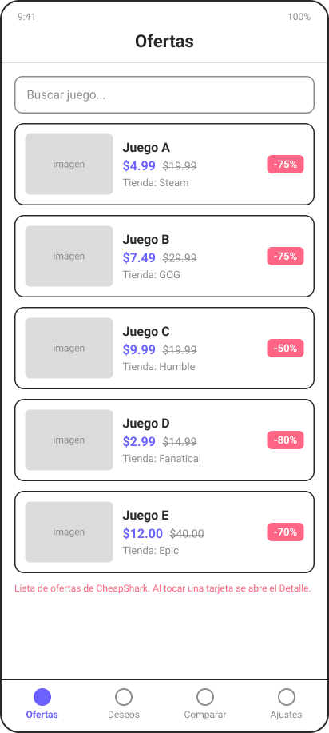
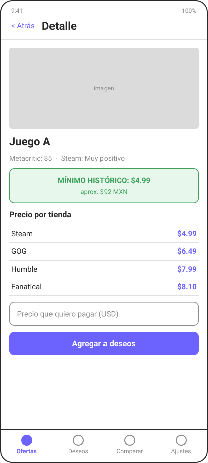
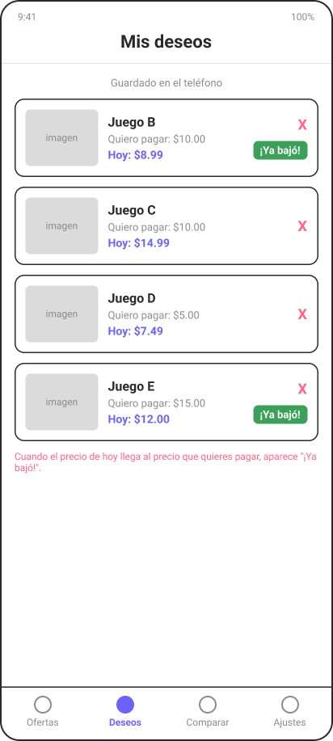
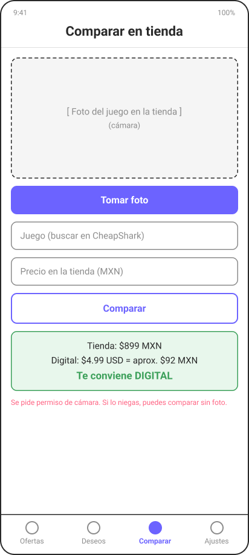
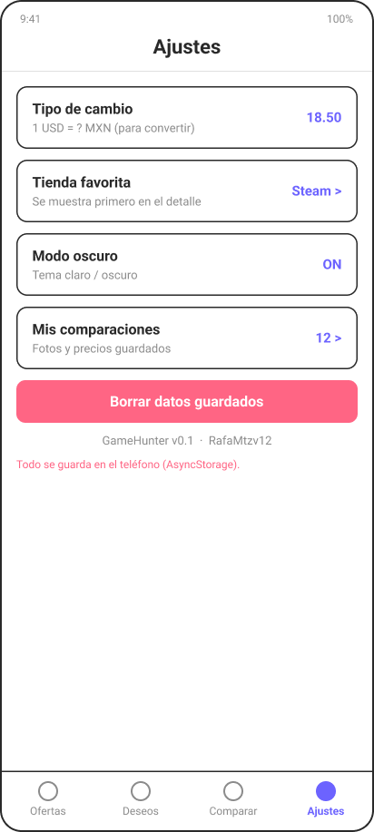

# Propuesta de proyecto final: GameHunter

**Materia:** Desarrollo Móvil
**Alumno:** Rafael de Jesús Martínez Vélez ([@RafaMtzv12](https://github.com/RafaMtzv12))
**Fecha:** 15 de noviembre de 2026
**Tecnología:** React Native con Expo (SDK 58), JavaScript

---

## 1. Nombre de la app y problema que resuelve

**GameHunter: cazador de ofertas de juegos de PC**

Los juegos de PC cambian de precio constantemente y cada tienda digital (Steam, Epic, GOG, Humble, Fanatical, etc.) tiene ofertas distintas. Revisarlas una por una es tedioso, y es difícil saber si un descuento es realmente bueno o si el juego ha estado más barato antes. Además, cuando ves un juego en una tienda física no sabes si te conviene comprarlo ahí o en digital. GameHunter reúne las ofertas de más de 30 tiendas en una sola app, indica si el precio actual es el mínimo histórico, guarda una lista de deseos con el precio que quieres pagar y compara el precio de una tienda física (con foto) contra el mejor precio digital.

## 2. Usuario objetivo

- Estudiantes y jugadores de PC con presupuesto limitado que quieren comprar sus juegos al mejor precio.
- Personas que no tienen tiempo de revisar varias tiendas todos los días y quieren saber de un vistazo si una oferta vale la pena.
- Jugadores que todavía compran en tiendas físicas (Liverpool, Walmart, GameStop) y quieren comparar antes de pagar.

## 3. Pantallas (5) y bocetos

Bocetos hechos en Figma: <https://www.figma.com/design/nwYCzOwH0Cf50qkbCrVrCL> (archivo "GameHunter - Bocetos", formato Android 412 x 917). Las imágenes de la carpeta `bocetos/` se exportaron de ese archivo.

Navegación con React Navigation: barra inferior con 4 pestañas (**Ofertas, Deseos, Comparar, Ajustes**) y la pantalla de **Detalle** se abre encima (pila) al tocar un juego.

| # | Pantalla | Descripción | Boceto |
|---|---|---|---|
| 1 | **Ofertas** | Lista de las mejores ofertas actuales: portada, título, precio de oferta, precio normal tachado, % de descuento y tienda. Buscador por nombre. Indicador de carga y mensaje de error con "Reintentar" si no hay internet. |  |
| 2 | **Detalle del juego** | Precio en cada tienda, precio más bajo histórico (aviso de "mínimo histórico"), calificaciones (Metacritic y Steam), precio aproximado en pesos y botón "Agregar a deseos" con el precio que el usuario quiere pagar. |  |
| 3 | **Mis deseos** | Juegos guardados en el teléfono con su precio objetivo. Al abrir la app se marca en verde "¡Ya bajó!" cuando el precio actual llega al objetivo. Se puede quitar un juego. |  |
| 4 | **Comparar en tienda** | Usa la **cámara** para tomar una foto del juego en la tienda física, el usuario escribe el precio que vio (MXN) y elige el juego; la app lo compara con el mejor precio digital convertido a pesos y dice "Te conviene digital" o "Te conviene aquí". Las comparaciones se guardan con su foto. |  |
| 5 | **Ajustes** | Tipo de cambio USD a MXN, tienda favorita, tema claro/oscuro, historial de comparaciones y botón para borrar los datos guardados. |  |

## 4. API pública (sesión 6)

**CheapShark API**: <https://apidocs.cheapshark.com/>

- Gratuita, pública y **sin llave** (no requiere registro ni token).
- Junta ofertas de más de 30 tiendas digitales de PC.
- Endpoints que se usarán (base `https://www.cheapshark.com/api/1.0`):

| Endpoint | Para qué |
|---|---|
| `GET /deals` | Lista de ofertas actuales (pantalla Ofertas, más de 20 elementos). |
| `GET /games?title=...` | Buscar un juego por nombre (buscador y pantalla Comparar). |
| `GET /games?id=...` | Detalle de un juego: precio en cada tienda y precio más bajo histórico. |
| `GET /stores` | Nombres y logotipos de las tiendas. |

- Respuestas en JSON; se manejan los estados de **carga**, **error** (sin internet, con botón "Reintentar") y **lista vacía**.
- Para los enlaces de compra se usarán los enlaces de redirección de CheapShark, como piden en su documentación.

## 5. Datos que se guardan localmente

Con **AsyncStorage** (la misma técnica de la actividad 0006):

| Dato | Para qué |
|---|---|
| Lista de deseos (juego, precio objetivo, fecha) | Pantalla Mis deseos; se conserva al cerrar la app. |
| Comparaciones en tienda (foto, juego, precio en tienda, precio digital, fecha) | Historial de compras inteligentes. |
| Tipo de cambio USD a MXN | Convertir los precios a pesos aproximados. |
| Tienda favorita y tema claro/oscuro | Preferencias del usuario. |
| Última lista de ofertas descargada | Mostrar algo útil cuando no hay internet. |

## 6. Sensor o permiso (sesión 7)

**Cámara** (`expo-image-picker` o `expo-camera`):

- Se pide el permiso en tiempo de ejecución, con un mensaje que explica para qué se usa: "Para tomar una foto del juego en la tienda y guardarla junto a la comparación de precios".
- Opción de tomar la foto o elegirla de la galería.
- **Si el usuario niega el permiso**, la app no se cierra: muestra un aviso y permite hacer la comparación sin foto.

## 7. Limitaciones conocidas y cómo se manejan

- **Precios en dólares (USD):** CheapShark da precios de EE. UU. y Steam en México tiene precios regionales en pesos. Por eso la app destaca el **% de descuento** y el **mínimo histórico** (que valen en cualquier país) y muestra el precio en pesos como **aproximado**, usando el tipo de cambio que el usuario guarda en Ajustes.
- **Solo juegos de PC:** CheapShark no incluye consolas; la comparación en tienda física aplica a ediciones de PC o como referencia.
- **Servicio gratuito sin garantía:** si la API falla, la app muestra un mensaje de error con "Reintentar" y la última lista guardada.

## 8. Plan de trabajo

| Fecha | Actividad | Qué se avanza en GameHunter |
|---|---|---|
| 15 nov | 0006 | Propuesta (este documento), repositorio y proyecto base de Expo. |
| Sesión 6 | 0007 Explorador de datos | Pantallas Ofertas y Detalle consumiendo CheapShark (carga, error, reintentar). |
| 28 nov | Sesión 7 | Cámara en Comparar en tienda, todas las pantallas navegables y AVANCE.md. |
| Hasta 5 dic | Entrega final | Deseos y Ajustes completos, ícono y nombre propios, README con capturas, APK en Releases y video demo. |
